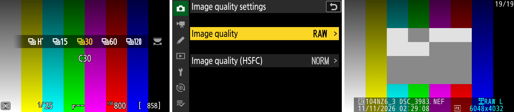

# z63patch

**Pro video and photo features for the Nikon Z6III, unlocked in firmware.**

3:2 open gate · RAW pre-capture · ProRes 422 grades · H.265 bitrate tiers · N-RAW quality tiers · anamorphic desqueeze

[Features](#features) · [Under investigation](#under-investigation) · [Screenshots](#screenshots) · [Road to hardware](#road-to-real-hardware) · [Support](#support-the-hardware-testing) · [Developers](#for-developers)

The Z6III's own Frame size/frame rate menu. The three <b>[FX 3:2] 6048x4032</b> entries are new: full-sensor open gate at 6K.

---

> [!CAUTION]
> **This has never been installed on a real camera, and you should not try yet.**
> Every build this project produces is marked `DO_NOT_FLASH`. A firmware crash early in startup could leave a Z6III that cannot be recovered without Nikon service. There are no install instructions here on purpose.

> [!IMPORTANT]
> **Help fund a test camera.** Development is stuck in the emulator because I can't risk bricking my only Z6III. A dedicated test body would let this move to real hardware. The goal is **$3,000**. [Support on Ko-fi](https://ko-fi.com/rdwing) or [read more](#support-the-hardware-testing).

## What this is

The Z6III shares its processor (EXPEED 7) and much of its firmware with the Nikon ZR. Some features the ZR has are missing from the Z6III, even though the hardware can probably handle them. z63patch aims to add them back, plus a number of exciting new features neither camera has.

Because the changes go into the camera's own firmware, the new options show up in Nikon's menus and save like any other setting. The aim is a tool working professionals can rely on, so colour and the small details get the same care as the headline features. Development and testing happen in a full-system emulator that boots the unmodified Z6III firmware.

## Features

| | Feature | What you get | Status in the emulator |
| :---: | --- | --- | --- |
| 🟢 | **[Open gate RAW](docs/features/open-gate.md)** | Full-sensor 3:2 N-RAW at 6048×4032 (6K) and 4032×2688 (4K), each at 30p, 25p and 24p, with a 3:2 view and AF area | Test recordings at both sizes with correct metadata |
| 🟢 | **[RAW pre-capture](docs/features/precapture.md)** | Pre-release capture in C15 and C30 saved as RAW, RAW+JPEG or JPEG | 94 complete RAW+JPEG pairs across all six JPEG grades |
| ⚪ | **Open gate for H.265 and ProRes, and at 50p/60p** | Full-sensor 3:2 recording in H.265 and ProRes, and open gate at 50p and 60p | Not built yet. Sensor timing and data rate for 50p/60p look sufficient on paper |
| 🟡 | **[ProRes 422 grades](docs/features/prores-grades.md)** | HQ, Standard, LT and Proxy instead of HQ only | Menus and indicators work; validation requires physical hardware testing |
| 🟢 | **[H.265 bitrate tiers](docs/features/h265-quality.md)** | 100%, 60%, 45%, 30% and 20% of the stock bitrate | Test recordings set Nikon's encoder to the chosen bitrate (checked at 100% and 60%) |
| 🟢 | **[N-RAW quality tiers](docs/features/nraw-quality.md)** | High (3.0 bits per pixel), Fine (2.0), Normal (1.5) and Basic (1.0). Fine and Basic are new. In 6K open gate, High uses 2.5 | Test recordings at all four tiers |
| 🟢 | **[Anamorphic desqueeze](docs/features/desqueeze.md)** | 1.25× to 2.00× live-view desqueeze, also combined with open gate | Works on the rear screen; viewfinder built but needs testing on hardware |
| 🟢 | **[Log options](docs/features/log.md)** | S-Log3 with S-Gamut3.Cine and Log3G10 with REDWideGamutRGB, next to the stock N-Log with BT.2020 | Test recordings in all three Log types decode with the right metadata. Colour was closely tuned for the Z6III but should still be checked against a chart on a real camera |
| ⚪ | **Pixel shift** | Merging of pixel-shift sequences | Desktop tools only so far |

🟢 works in the emulator · 🟡 partly working · ⚪ not in the camera firmware yet

Everything in this table was tested in the emulator only. None of it has run on a camera. Click a feature for how it works and what's still unknown.

### Under investigation

These are in no particular order. Items marked *feasibility* first need research to see whether they're possible at all.

<table>
<tr>
<td valign="top" width="50%">

**Video**
- R3D NE recording
- The ZR's R3D NE interface on the Z6III
- Optimized N-Log curve (+1 to 2 EV)
- Sensor gain adjustment like the ZR's R3D NE mode (+1 EV)
- Fix black level flickering
- Non-HQ ProRes RAW for lower bitrates (*feasibility*)
- Lens distortion metadata in ProRes RAW (*feasibility*)
- Dual-card video recording (*feasibility*)
- Gyro data embedded in recordings, or at least a gyro sidecar file
- IBIS/VR for video: find and eliminate hitching

**Image quality**
- Optimized noise reduction for stills and video
- DGO mode for stills and video (stretch goal)

**Stills**
- Sustained C30/C60 RAW bursts, not just pre-capture
- SDR RAW+HEIF

</td>
<td valign="top" width="50%">

**Monitoring and looks**
- False colour
- Zebras in live view for stills
- Better wireless video monitoring
- `.cube` LUT import and monitoring
- `.cube` LUT import for stills looks
- Remove or reprogram the stock Creative Picture Control slots

**Autofocus**
- Better AF behaviour
- Improved subject detection
- Improved eye-detection AF

**Playback and menus**
- Desqueeze in playback and previews
- N-RAW quality names in playback, such as "N-RAW FINE"
- Translated menus (the new rows are English only for now)

</td>
</tr>
</table>

## Screenshots

All screenshots come from the emulator. The colour bars are its stand-in for the image sensor.

<table>
  <tr>
    <td width="50%"> <b>ProRes 422</b>: four grades instead of one</td>
    <td width="50%"> <b>H.265</b>: five bitrate tiers, 188 down to 38 Mbps</td>
  </tr>
  <tr>
    <td> <b>N-RAW</b>: four quality tiers for longer recording per card</td>
    <td> <b>Desqueeze</b>: preview anamorphic footage correctly</td>
  </tr>
  <tr>
    <td colspan="2"> <b>Pre-capture</b>: select C30, set Image quality to RAW, and the burst is saved as NEF files. Stock firmware uses the separate Image quality (HSFC) setting in C15 and C30 instead. In this emulator run, one C30 burst wrote 17 NEFs; playback shows the last one as RAW L, 6048×4032.</td>
  </tr>
</table>

## Road to real hardware

The emulator can show that a patch behaves correctly. It can't show whether a real camera will accept the update and write it safely, or whether the camera can be restored if something goes wrong. Cameras get bricked at exactly those steps.

If the patched firmware crashes before the camera reaches its Setup menu, there is no known way for an owner to put the original firmware back, because Nikon's normal update path needs a working menu.

So hardware testing goes in small steps, each on a camera that can be lost:

## Support the hardware testing

I only have one Z6III, and it's my working camera. I can't risk bricking it, so development has stalled at the emulator.

What the project needs is a dedicated test body: a used Z6III that only ever receives experimental firmware. With one, testing can move to real hardware without putting anyone's main camera at risk. **The goal is $3,000**, and every contribution brings real-hardware testing closer.

Please read this before you give anything:

- **This pays for research and test hardware. You aren't buying anything.** There's no promise the patch will ever be safe to install, and the test camera may be destroyed along the way.
- If the fund is never used for a test body, I'll say what happened to it here.
- Every hardware result will be published in this repository, failures included.

### Other ways to help

- Donate a damaged or retired Z6III. A body with cosmetic damage or a dead shutter can still test firmware.
- If you know how Nikon service centres reflash a camera that won't start, please open an issue.
- Read the [feature docs](docs/features/) and open an issue if something looks wrong or you know more about how the Z6III works.
- Tell other Z6III shooters who want these features.

Please don't test builds on your own camera and send results. If a flash fails, your camera may not be recoverable.

## For developers

The patch builder isn't published yet. It will be added to this repository later, under GPL-3.0.

It takes **your own** decrypted Z6III C2.01 firmware image and produces an image for the emulator only, marked `DO_NOT_FLASH`, with a manifest of every changed byte range. A separate verifier checks every byte against a frozen recipe. No Nikon firmware will ever be included here.

Until then, the [feature docs](docs/features/) explain how each feature works and what's still unknown.

## Related projects

- [RdWing/z8-qemu](https://github.com/RdWing/z8-qemu): an emulator for the Nikon Z8 (firmware C3.11). It runs Nikon's own menus and shooting tasks and can capture RAW files to a virtual card.
- [Fenestra for the Z6III](https://github.com/RdWing/Fenestra/tree/z63-c201-port): my fork of Fenestra, a runtime that loads independent modules from a memory card and gives them a menu inside the camera. The fork adds a Z6III C2.01 port that runs in the emulator. Like everything here, it is `DO_NOT_FLASH`.
- [nikon-lut-to-np3](https://github.com/RdWing/nikon-lut-to-np3): a browser app that fits an N-Log `.cube` LUT to a Flexible Color Picture Control (NP3), so you can use the look in stills.

## Credits and legal

- A few builder components, such as the ELF linker and the NEF writer, are adapted from [XinmiaoZhao/NikonFirmwarePatch](https://github.com/XinmiaoZhao/NikonFirmwarePatch) (GPL-3.0). [NOTICE.md](NOTICE.md) lists exactly what was adapted.
- Licensed under [GPL-3.0](LICENSE). The license grants no rights to Nikon firmware.
- Not affiliated with or endorsed by Nikon. Nikon, Z6III, N-RAW and N-Log are trademarks of Nikon Corporation. ProRes is a trademark of Apple Inc.
- Modifying camera firmware will probably void your warranty and can permanently damage your camera. This software is provided without warranty of any kind.
