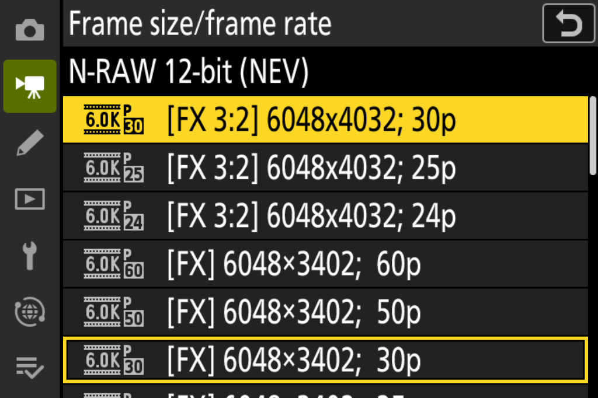
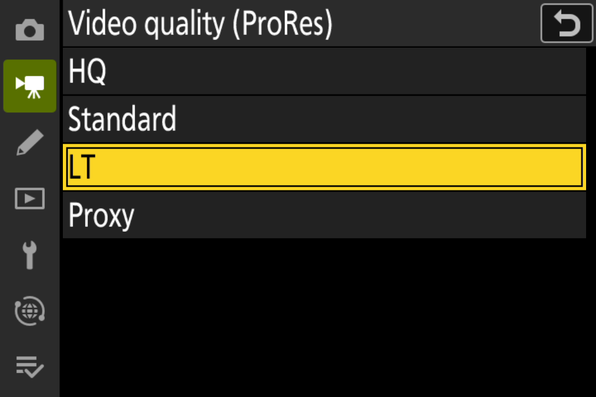
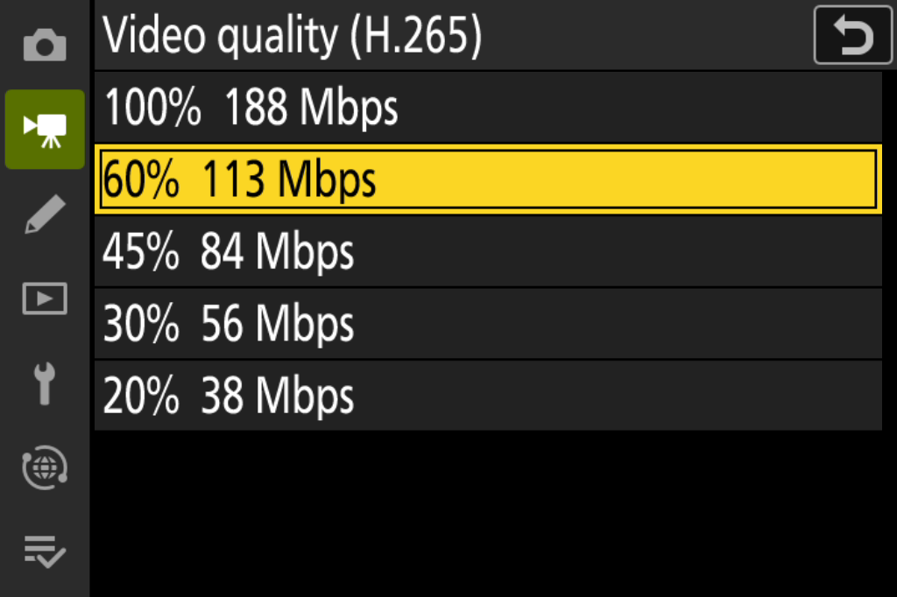
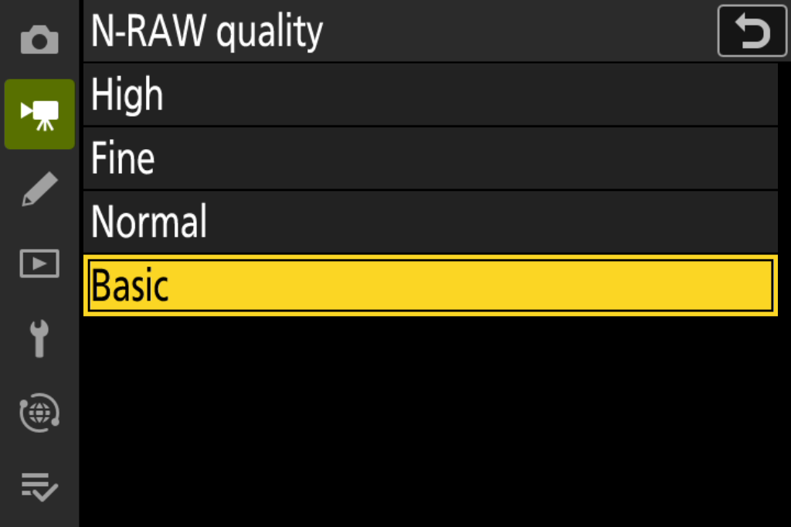
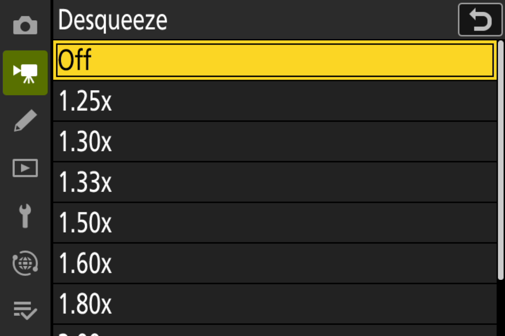
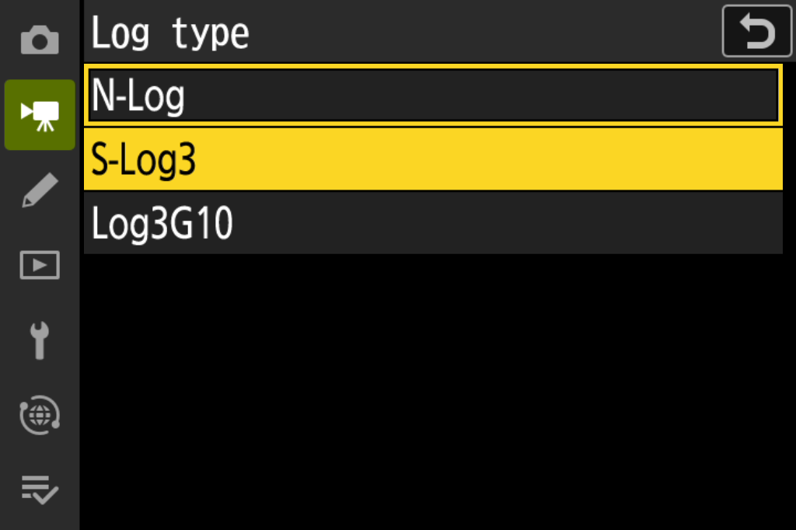
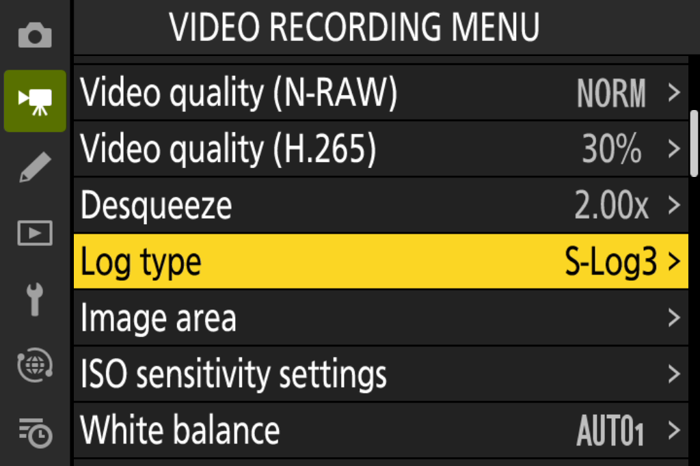
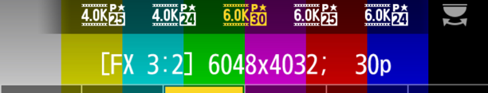

# z63patch

**Pro video features for the Nikon Z6III, unlocked in firmware.**

3:2 open gate · ProRes 422 grades · H.265 bitrate tiers · N-RAW quality tiers · S-Log3 and Log3G10 · anamorphic desqueeze

[Status](#current-status) · [Features](#features) · [How it works](#how-it-works) · [Known limits](#known-limits) · [What you will need](#what-you-will-need) · [Using the patcher](#using-the-patcher) · [Safety](#safety-and-responsibility) · [Support](#support-the-hardware-testing)

The Z6III's own Frame size/frame rate menu, in the emulator. The <b>[FX 3:2]</b> entries are new: full-sensor open gate at 6K and 4K.

---

> [!CAUTION]
> **This has never been installed on a real camera, and you should not try yet.**
> Every build this project produces is marked `DO_NOT_FLASH`. A firmware crash early in startup could leave a Z6III that cannot be recovered without Nikon service. There are no install instructions here on purpose.

> [!IMPORTANT]
> **Help fund a test camera.** Development is stuck in the emulator because I can't risk bricking my only Z6III. A dedicated test body would let this move to real hardware. The goal is **$3,000**. [Support on Ko-fi](https://ko-fi.com/rdwing) or [read more](#support-the-hardware-testing).

## Current status

- Every feature in the table below works in an emulator of the Z6III that runs the camera's own firmware.
- Nothing has been installed on a real camera yet. The first install hasn't happened.
- If an installed firmware fails to start, there is no known way to recover the camera without Nikon service.

## What this is

The Z6III shares its processor (EXPEED 7) and much of its firmware with the Nikon ZR. Some features the ZR has are missing from the Z6III, even though the hardware can probably handle them. z63patch aims to add them back, plus a number of new features neither camera has.

Because the changes go into the camera's own firmware, the new options show up in Nikon's menus and save like any other setting. The aim is a tool working professionals can rely on, so colour and the small details get the same care as the headline features. Development and testing happen in a full-system emulator that boots the unmodified Z6III firmware.

## Features

There is one build, and it contains every feature marked 🟢 or 🟡 below. Features marked 🔧 are being worked on and are not in the build yet.

| | Feature | What you get | Status in the emulator |
| :---: | --- | --- | --- |
| 🟢 | **[Open gate RAW](docs/features/open-gate.md)** | Full-sensor 3:2 N-RAW at 6048×4032 (6K) and 4032×2688 (4K), each at 30p, 25p and 24p, chosen as a frame size in the menu or the i-menu, with a 3:2 view and AF area | Selection, live view and AF work; a short 3:2 test clip has the correct size information |
| 🟡 | **[ProRes 422 grades](docs/features/prores-grades.md)** | HQ, Standard, LT and Proxy instead of HQ only | Menus and indicators work; the emulator can't record ProRes, so this needs a real camera |
| 🟢 | **[H.265 bitrate tiers](docs/features/h265-quality.md)** | 100%, 60%, 45%, 30% and 20% of the stock bitrate | Test recordings set Nikon's encoder to the chosen bitrate (checked at 100% and 60%) |
| 🟢 | **[N-RAW quality tiers](docs/features/nraw-quality.md)** | High (3.0 bits per pixel), Fine (2.0), Normal (1.5) and Basic (1.0). Fine and Basic are new. In 6K open gate, High uses 2.5 | Test recordings at all four tiers |
| 🟢 | **[Anamorphic desqueeze](docs/features/desqueeze.md)** | 1.25× to 2.00× live-view desqueeze, also combined with open gate | Works on the rear screen; viewfinder needs testing on a camera |
| 🟢 | **[Log curves and colour spaces](docs/features/log.md)** | Two more Log types, each a log curve together with its own colour space: S-Log3 with S-Gamut3.Cine, and Log3G10 with REDWideGamutRGB, next to the stock N-Log with BT.2020. Choosing a Log type changes both the curve and the colour space of the recording. View assist for each | Test recordings in all three Log types decode with the right metadata. Colour and view assist should still be checked on a real camera |
| 🔧 | **[RAW pre-capture](docs/features/precapture.md)** | C15 and C30 pre-release bursts saved as RAW, RAW+JPEG or JPEG (stock saves JPEG only) | In progress. Worked in the emulator in an earlier build; not yet in the current build |

🟢 works in the emulator · 🟡 partly working · 🔧 in progress, not in the current build

Click a feature for how it works and what's still unknown.

**Not in the current build:**

- **Open gate for H.265 and ProRes, and at 50p/60p** isn't built yet. Sensor timing and data rate for 50p/60p look sufficient on paper.
- **Pixel shift** merging exists as desktop tools only.

### Under investigation

These are in no particular order. Items marked *feasibility* first need research to see whether they're possible at all.

<table>
<tr>
<td valign="top" width="50%">

**Video**
- R3D NE recording
- The ZR's R3D NE interface on the Z6III
- Optimized N-Log curve (+1 to 2 EV)
- Sensor gain adjustment like the ZR's R3D NE mode (+1 EV)
- Fix black level flickering
- Non-HQ ProRes RAW for lower bitrates (*feasibility*)
- Lens distortion metadata in ProRes RAW (*feasibility*)
- Dual-card video recording (*feasibility*)
- Gyro data embedded in recordings, or at least a gyro sidecar file
- IBIS/VR for video: find and eliminate hitching

**Image quality**
- Optimized noise reduction for stills and video
- DGO mode for stills and video (stretch goal)

**Stills**
- Sustained C30/C60 RAW bursts
- SDR RAW+HEIF

</td>
<td valign="top" width="50%">

**Monitoring and looks**
- False colour
- Zebras in live view for stills
- Better wireless video monitoring
- `.cube` LUT import and monitoring
- `.cube` LUT import for stills looks
- Remove or reprogram the stock Creative Picture Control slots

**Autofocus**
- Better AF behaviour
- Improved subject detection
- Improved eye-detection AF

**Playback and menus**
- Desqueeze in playback and previews
- N-RAW quality names in playback, such as "N-RAW FINE"
- Translated menus (the new rows are English only for now)

</td>
</tr>
</table>

## How it works

The full description is in [How the patch behaves](docs/how-it-works.md). In short:

- **Off until you opt in.** The installed firmware behaves like stock until you put a small arm file on the memory card. With the card removed, or without the file, the camera is stock.
- **Switching on.** With the arm file present, the features switch on a few seconds after power-on, in photo or movie mode. The patch waits while a menu, playback or the i-menu is open or a recording is running.
- **Switching off.** Removing the card returns the camera to stock behaviour. In movie mode this happens once you switch to photo mode. It never happens in the middle of a recording.
- **Firmware updates** are refused while the patch is active, and never when it isn't. To update, remove the card or the arm file, switch the camera off with the power switch for at least 10 seconds, switch it on, then update as usual.
- **One build, one switch.** Every feature is in the same build. The arm file switches the whole patch on or off; there is no choice of individual features.

## Known limits

The full list is in [Known limits](docs/known-limits.md). The main ones:

- After power-on in movie mode, a stored 3:2 frame size or desqueeze ratio takes effect at the first recording start, lever move, card change or changed setting, not immediately.
- To leave open gate, choose any regular frame size, in the menu or with the dial in the i-menu. One quirk: the i-menu's full list opens with the regular size already highlighted, and pressing OK on it without moving changes nothing.
- A recording started by remote, app or HDMI trigger at the moment the patch switches on may give one ProRes clip at an inconsistent grade.

## Screenshots

All screenshots come from the emulator. The colour bars are its stand-in for the image sensor.

<table>
  <tr>
    <td width="50%"> <b>ProRes 422</b>: four grades instead of one</td>
    <td width="50%"> <b>H.265</b>: five bitrate tiers, 188 down to 38 Mbps. This is from an earlier build. The current build labels the tiers with percentages only.</td>
  </tr>
  <tr>
    <td> <b>N-RAW</b>: four quality tiers for longer recording per card</td>
    <td> <b>Desqueeze</b>: preview anamorphic footage correctly</td>
  </tr>
  <tr>
    <td width="50%"> <b>Log type</b>: each option is a log curve with its own colour space: N-Log with BT.2020, S-Log3 with S-Gamut3.Cine, Log3G10 with REDWideGamutRGB</td>
    <td width="50%"> <b>Where it is</b>: the Log type row in the video recording menu</td>
  </tr>
  <tr>
    <td colspan="2"> <b>Open gate in the i-menu</b>: the six 3:2 options follow the regular frame sizes on the strip, and the title line reads [FX 3:2].</td>
  </tr>
</table>

## What you will need

You need:

- **A Nikon Z6III on firmware C2.01.**
- **Nikon's official C2.01 firmware file** for the Z6III, unmodified, as Nikon distributes it.
- **Key material for that firmware:** three values, an AES-256 key (32 bytes), a 16-byte counter block and an 8-byte digest suffix. You supply them yourself, in any common file format (for example JSON, hex text, base64 or raw binary).
- **An exFAT-formatted card** for N-RAW and open gate. This is the camera's own rule for RAW video.

The patcher checks that the firmware file is Nikon's unmodified C2.01 and that the key material is correct for it. It refuses any other file or material.

## Using the patcher

The patch is published as a source-only patcher. It runs on your own computer, works on your own copy of Nikon's firmware file and your own key material, and produces the patched update file from them. The repository contains no Nikon firmware, original or modified, and no key material.

[Using the patcher](docs/using-the-patcher.md) explains how to build and check the file, what the patcher refuses, how to make the arm file and how to go back to stock.

## Road to real hardware

The emulator can show that a patch behaves correctly. It can't show whether a real camera will accept the update and write it safely, or whether the camera can be restored if something goes wrong. Cameras get bricked at exactly those steps.

If the patched firmware crashes before the camera reaches its Setup menu, there is no known way for an owner to put the original firmware back, because Nikon's normal update path needs a working menu.

So hardware testing goes in small steps, each on a camera that can be lost:

## Safety and responsibility

Installing modified firmware can permanently disable a camera. This project comes with no warranty of any kind, and modifying your camera's firmware will probably void Nikon's warranty. If you install it, you do so at your own risk.

What the project does to reduce the risk:

- **Inert until armed.** Without the arm file on the card, the firmware behaves like stock, so a camera can be used normally without the patch running.
- **Updates stay possible.** Firmware updates are refused only while the patch is active. In any power-on where it never switched on, updating works as on stock firmware.
- **Small footprint.** Only the camera's main firmware is changed. The other parts of Nikon's update file are passed through unchanged, and the camera's startup program is never touched. The patch doesn't write to the camera's firmware memory itself. Its settings are saved through the camera's own settings save.
- **Checked inputs and outputs.** The patcher accepts only Nikon's unmodified C2.01 file and the matching key material. It then checks the patched result independently and refuses to write it if anything is outside the expected changes.

None of this removes the main risk: if a patched firmware fails to start on a real camera, **<ins>there is no known way to recover it</ins>**.

## Support the hardware testing

I only have one Z6III, and it's my working camera. I can't risk bricking it, so development has stalled at the emulator.

What the project needs is a dedicated test body: a used Z6III that only ever receives experimental firmware. With one, testing can move to real hardware without putting anyone's main camera at risk. **The goal is $3,000**, and every contribution brings real-hardware testing closer.

Please read this before you give anything:

- **This pays for research and test hardware. You aren't buying anything.** There's no promise the patch will ever be safe to install, and the test camera may be destroyed along the way.
- If the fund is never used for a test body, I'll say what happened to it here.
- Every hardware result will be published in this repository, failures included.

### Other ways to help

- Donate a damaged or retired Z6III. A body with cosmetic damage or a dead shutter can still test firmware.
- If you know how Nikon service centres reflash a camera that won't start, please open an issue.
- Read the [feature docs](docs/features/) and open an issue if something looks wrong or you know more about how the Z6III works.
- Tell other Z6III shooters who want these features.

Please don't test builds on your own camera and send results. If a flash fails, your camera may not be recoverable.

## Related projects

- [RdWing/z8-qemu](https://github.com/RdWing/z8-qemu): an emulator for the Nikon Z8 (firmware C3.11). It runs Nikon's own menus and shooting tasks and can capture RAW files to a virtual card.
- [Fenestra for the Z6III](https://github.com/RdWing/Fenestra/tree/z63-c201-port): my fork of Fenestra, a runtime that loads independent modules from a memory card and gives them a menu inside the camera. The fork adds a Z6III C2.01 port that runs in the emulator. Like everything here, it is `DO_NOT_FLASH`.
- [nikon-lut-to-np3](https://github.com/RdWing/nikon-lut-to-np3): a browser app that fits an N-Log `.cube` LUT to a Flexible Color Picture Control (NP3), so you can use the look in stills.

## Credits and legal

- A few builder components, such as the ELF linker and the Log tables, are adapted from [XinmiaoZhao/NikonFirmwarePatch](https://github.com/XinmiaoZhao/NikonFirmwarePatch) (GPL-3.0). [NOTICE.md](NOTICE.md) lists exactly what was adapted.
- Copyright (C) 2026 RdWing. Licensed under [AGPL-3.0-only](LICENSE); the files adapted from upstream stay under [GPL-3.0-only](LICENSES/GPL-3.0-only.txt). Each source file's SPDX header names its license. The license grants no rights to Nikon firmware.
- **Building on this?** You're welcome to, under the license. Please credit z63patch and link back to [RdWing/z63patch](https://github.com/RdWing/z63patch) in your README or release notes. The license also requires you to keep the copyright notices and file headers and to publish your source.
- Not affiliated with or endorsed by Nikon. Nikon, Z6III, N-RAW and N-Log are trademarks of Nikon Corporation. ProRes is a trademark of Apple Inc. S-Log3 and S-Gamut3.Cine are trademarks of Sony Group Corporation. Log3G10 and REDWideGamutRGB are trademarks of RED Digital Cinema.
- Modifying camera firmware will probably void your warranty and can permanently damage your camera. This software is provided without warranty of any kind.
