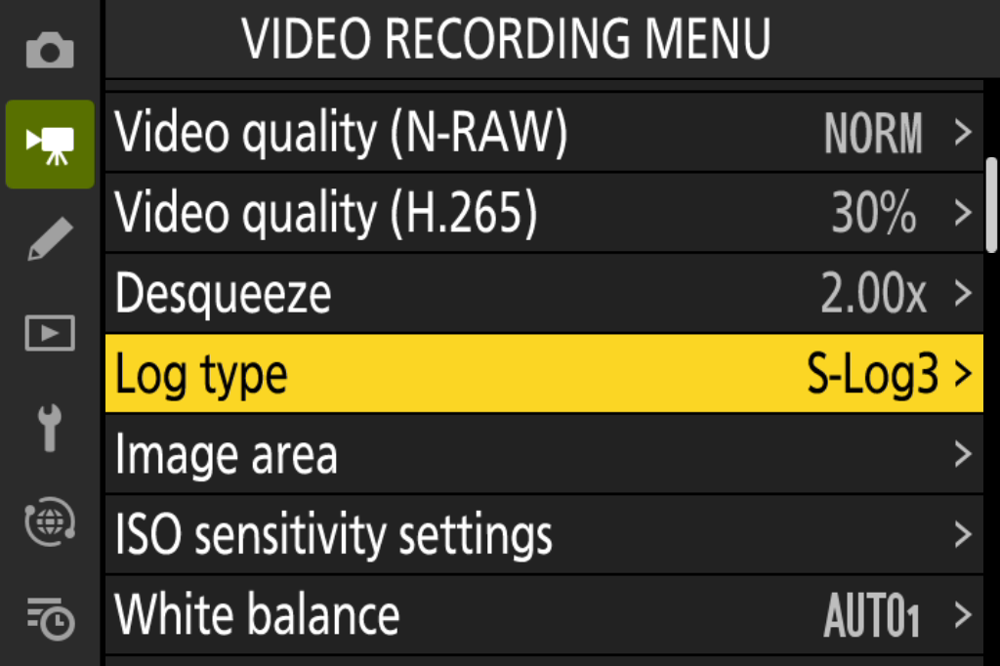

# Log options

Status: 🟢 works in the emulator. Never run on a camera.

## What it does

The Z6III's only Log option is N-Log with BT.2020. z63patch adds two more, each with its own colour space:

| Log type | Colour space |
| --- | --- |
| N-Log (stock) | BT.2020 |
| S-Log3 | S-Gamut3.Cine |
| Log3G10 | REDWideGamutRGB |

This lets Z6III footage drop into workflows and LUTs built for those formats, and match other cameras on the same shoot.

## How you use it

Set the tone mode to N-Log as usual, then choose N-Log, S-Log3 or Log3G10 under **Log type** in the video recording menu.

*Emulator screenshot: the Log type row in the video recording menu.*

Tone mode itself stays on Nikon's N-Log setting; the Log type row decides which curve and colour space are recorded. The choice takes effect from the next recording and is tagged in the file, so editing software knows which curve and colour space it holds. Like the other z63patch settings, it is one setting for the whole camera, not stored per shooting menu bank.

## Design notes

Each Log type changes both the curve and the colour conversion, so S-Log3 comes with S-Gamut3.Cine and Log3G10 with REDWideGamutRGB. When you pick one, the camera's own colour pipeline swaps in that type's curve and matrices at the points where it would use N-Log's, so the footage is encoded directly in the new format.

S-Log3's colour conversion is computed for the Z6III's sensor from the camera's own colour data. Log3G10 uses a colour conversion suited to that curve and colour space, with the camera's own per-unit colour correction kept. The curves follow the published S-Log3 and Log3G10 specifications.

## View assist

With S-Log3 or Log3G10 selected, view assist shows a normal-contrast preview on the rear monitor and in the viewfinder, in the same way as the camera's own N-Log view assist. Each screen has its own conversion. The recording isn't affected.

## Tested so far

Some of these checks were made on an earlier build of the same feature.

- Emulator recordings in all three Log types, each decoding with the right Log and colour space metadata.

The emulator stands in for the image sensor, so it can't measure colour accuracy.

## Still unknown

- Colour accuracy on a real camera. It should be checked against a chart under several white balances and exposures before anyone relies on it.
- How view assist looks on the rear monitor and in the viewfinder. The emulator can't show the assisted picture.
- The tone mode page still reads N-Log whichever Log type is chosen.
- Whether the same conversion holds for N-RAW proxies and every codec.
