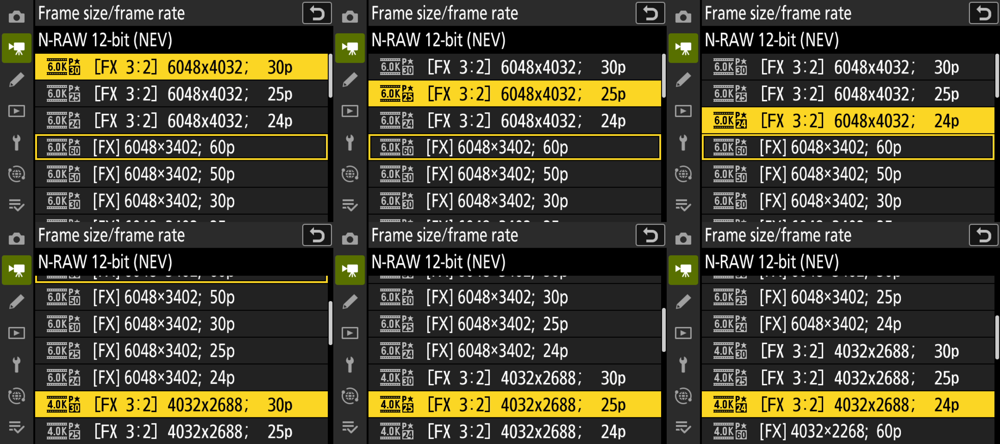
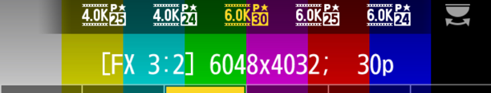

# Open gate RAW

Status: 🟢 works in the emulator. Never run on a camera.

## What it does

The Z6III records video from a 16:9 window of its sensor. Open gate records the full 3:2 sensor height instead, so you get more image above and below the frame to reframe, stabilise or crop for vertical delivery later.

Six frame sizes are added, all in N-RAW:

| Menu entry | Recorded size | Frame rates |
| --- | --- | --- |
| [FX 3:2] 6048x4032 | 6K, full sensor | 30p, 25p, 24p |
| [FX 3:2] 4032x2688 | 4K, scaled from the full sensor | 30p, 25p, 24p |

## How you use it

Open gate is a frame size. With N-RAW as the file type, choose one of the `[FX 3:2]` entries in either place:

- **Frame size/frame rate** in the video recording menu. The entries use the same 6K and 4K icons as the regular sizes, with an `[FX 3:2]` label.
- The frame size control in the **i-menu**. The six 3:2 options come after the regular ones, and the line above the strip reads `[FX 3:2]` for them.

Open gate is on only while a 3:2 frame size is selected. Choosing any regular frame size, in either place, or switching to another file type, turns it off.

N-RAW needs an exFAT-formatted card. This is the camera's own rule and applies to open gate too.

When open gate is on:

- Live view switches to a 3:2 picture, and the red recording border surrounds the whole 3:2 frame.
- AF areas and touch focus cover the 3:2 frame.
- Recorded files carry the full-frame size and crop information, so editing software sees a 3:2 clip.
- It combines with [anamorphic desqueeze](desqueeze.md).

Emulator screenshot: the six `[FX 3:2]` entries on the Frame size/frame rate page, each highlighted in turn.

Emulator screenshot: the i-menu frame size strip on a 3:2 option. The colour bars stand in for the image sensor.

## Design notes

Open gate reuses the sensor's full-height readout, which the camera already has for stills, and feeds it into the normal N-RAW recording path. The patch also updates the menus, the i-menu, live view, AF and playback to handle the taller frame.

In 6K open gate the frame is about 18% taller than 16:9 6K, so the data per second would go up by the same amount. To stay within the rates the camera already handles, High quality uses 2.5 bits per pixel in 6K open gate instead of 3.0. The other [N-RAW tiers](nraw-quality.md) are unchanged.

## Tested so far

All in the emulator:

- Choosing the 3:2 sizes on the frame size page and on the i-menu strip, saving the choice, and turning it off again with a regular size or another file type.
- Live view, the recording border, AF areas and touch in 3:2, also with desqueeze.
- Removing the card while open gate is on.
- A short 6K 3:2 test clip with 6048x4032 size information in the file.

The emulator stands in for the image sensor and the RAW encoder, so it can't judge the picture itself.

## Still unknown

- Whether the real sensor and RAW encoder accept full-height readout at video frame rates. This is the biggest open question, and only a camera can answer it.
- Real-length clips, heat and sustained recording time.
- Remaining-time and bitrate figures in the menus haven't been checked against real files.

See also [known limits](../known-limits.md): after power-on in movie mode a stored 3:2 choice takes effect only at the next recording, lever move, card change or changed setting, and pressing OK on the highlighted regular size in the i-menu list doesn't switch 3:2 off.

Open gate in H.265 and ProRes, and at 50p and 60p, isn't built. On paper the sensor timing and data rate for 50p/60p look sufficient.
